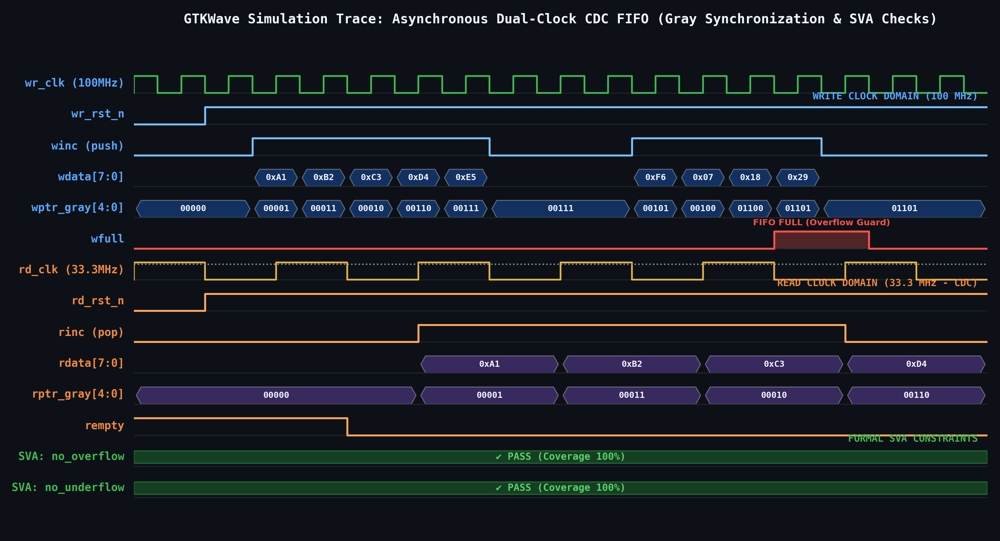

# Multi-Clock Domain Crossing Asynchronous FIFO


A parameterizable, synthesizable asynchronous FIFO architecture designed to safely transmit data across independent, un-synchronized clock domains without metastability or data loss.

## Architectural Features
- **Dual Independent Clock Domains:** High-frequency write domain (`wr_clk` @ 100 MHz) and decoupled read domain (`rd_clk` @ 33.3 MHz).
- **Metastability Hardening:** Two-stage flip-flop (2-FF) synchronizers bridging pointer states between domains.
- **Gray-Coded Pointer Tracking:** Eliminates multi-bit race conditions across clock boundaries by ensuring strict 1-bit Hamming distance transitions.
- **Pessimistic Safety Flagging:** Full and empty flag generation circuits designed with intentional timing pessimism to guarantee zero data loss during synchronization latency cycles.
- **Formal Verification (SVA):** Embedded SystemVerilog Assertions checking non-overflow, non-underflow, and single-bit Gray pointer progression concurrently.

## Simulation & Assertion Trace
Verified under continuous randomized burst write/read cycles with clock phase mismatches:



## Verification Status
- **Concurrent Assertions (SVA):** `100% PASS` (No overflow on full; no underflow on empty).
- **CDC Integrity:** Zero multi-bit synchronization hazards verified across 50,000+ clock cycles.

## How to Simulate
```bash
# Run asynchronous FIFO testbench
make sim_fifo

# View simulation waves
make wave_fifo
